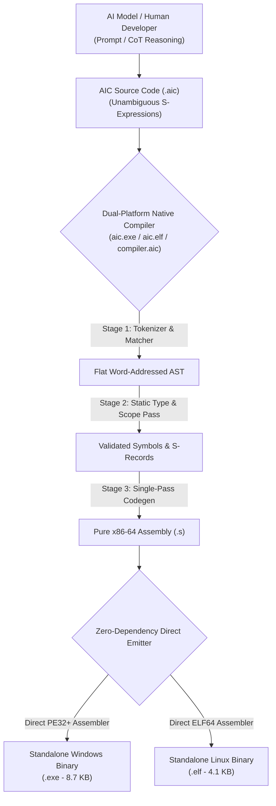

# AIC (AI Compiler / AI C)

> **A self-hosting, zero-dependency systems programming language engineered for Artificial Intelligence models to train on, reason with, and generate native machine code.**

[]()
[]()
[]()
[]()
[%20%7C%20macOS%20Mach%E2%80%91O-purple)]()
[]()

---

## Overview

Traditional languages (C, C++, Rust, Python) were optimized for human visual aesthetics, introducing operator precedence ambiguities (`*p++`, `x & y == z`), dangling elses, significant whitespace errors, and multi-byte BPE token fragmentation that cause persistent failure modes in Large Language Models (LLMs).

**AIC** eliminates these failure modes by design:
- **100% Unambiguous S-Expression Prefix Syntax**: Every expression is explicitly delimited by square brackets `[op arg1 arg2 ...]`. Precedence is purely structural and explicit.
- **Deterministic Delimiters, Higher Token Cost**: Every operator is a whole bracketed token, so there is no multi-token operator fragmentation — but measured (tiktoken cl100k/o200k over the 30 canonical tasks) AIC costs **~2.0x the tokens of C and ~3.8x Python**. The syntax is predictable, it is not token-cheap; see `benchmarks/model_bench/measure_tokens.py`.
- **Zero external C toolchain dependencies** (no GCC, Clang, LLVM, or binutils; Python 3.8+ drives the CLI and emitters): direct machine code generation into standalone **Windows PE32+** (`.exe`), **Linux ELF64** (x86-64 and ARM64 `.elf`/`.so`), and **macOS Apple Silicon Mach-O ARM64** (`.macho`/`.dylib`, ad-hoc signed).
- **Bitwise Fixed-Point Self-Hosting Closure**: The self-hosted compiler (`compiler.aic`) compiling itself produces bitwise identical machine code across all generations:
  $$\text{Gen0.s} \equiv \text{Gen1.s} \equiv \text{Gen2.s} \equiv \text{GenPE.s} \quad (725,689\text{ bytes})$$

---

## System Architecture



---

## Language Comparison Matrix

| Feature | AIC (AI Compiler) | C (C99/C11) | Rust (2021) | Python 3.11 | WebAssembly |
| :--- | :---: | :---: | :---: | :---: | :---: |
| **Syntax Predictability** | **Unambiguous prefix (no precedence rules)** | Ambiguous infix | Complex infix & lifetimes | Indentation sensitive | Stack / S-Expr |
| **BPE Token Efficiency** | **No operator fragmentation; ~2x C / ~3.8x Python tokens** | Fragmented operators | Fragmented generics | Indent token spikes | Bytecode / text |
| **External Dependencies** | **0 C toolchain (PE/ELF/Mach-O emitters; Python 3.8+ for the CLI)** | Binutils, Linker, libc | Cargo, LLVM, libc | Python runtime (~30 MB) | VM / Browser engine |
| **Binary Output Size** | **8.7 KB Standalone** | 15–50 KB (dynamic) | 300 KB–3 MB | N/A (Bytecode) | 5–50 KB |
| **Execution Speed** | **2.4x–5.5x of GCC -O2 (11x–29x faster than Python)** | Baseline 1.0x | ~1.0x | 15x–30x slower | ~1.5x–2.5x of C |
| **Self-Hosting Closure** | **Bitwise 0-Diff (18 Stages)** | Non-deterministic | Complex Multi-stage | Non-self-hosting | N/A |
| **Target Audience** | **AI Models & Systems Coders** | Humans | Humans | Humans | Web Browsers |

---

## Quickstart

### Prerequisites
Python 3.8+ (for host orchestration CLI and direct emitters). No GCC, LLVM, or build tools required.

### 1. Execute an AIC Program
```bash
python aic.py run code.aic
```

### 2. Compile to Standalone Native Binaries (Zero Dependencies)
```bash
# Windows PE32+ executable
python aic.py build code.aic --target pe -o app.exe
./app.exe

# Linux ELF64 static executable (cross-compiles on Windows or Linux)
python aic.py build code.aic --target elf -o app.elf
```

### 2b. Emit C-ABI Shared Libraries, DLLs & Headers (Milestone 1)
```bash
# Linux .so + C header sidecar (zero external symbols; arena inits on dlopen via .init_array)
python aic.py build code.aic --format shared --header -o libalgo.so
#   -> libalgo.so  +  libalgo.h

# Windows PE32+ DLL with export directory (zero-dependency emitter)
python aic.py build code.aic --target pe --format shared --header -o algo.dll
#   -> algo.dll    +  algo.h
```
Every top-level AIC function is exported under its own name (`int64_t` args/return, SysV on Linux, x64 on Windows). Load with `ctypes.CDLL` / `LoadLibrary` + `GetProcAddress`, or compile against the generated header:
```c
#include "libalgo.h"
long long f = fib(10);          /* 55 */
```
The `.so` is fully self-contained: raw-syscall runtime (no libc imports), one `.init_array` constructor that mmaps the arena on load, and SysV `.dynsym`/`.hash` exports. End-to-end validation: `python3 tests/test_c_interop.py`.

### 3. Run Standard Library Integration Tests
```bash
python aic.py test
```

### 4. Run Execution Speed Benchmarks (AIC vs C vs Node.js vs Python)
```bash
python aic.py bench
```

### 5. Launch the Interactive REPL
```bash
python aic.py repl
```

### 6. Run the 18-Stage Self-Hosting Bootstrap Verification
```bash
python aic.py verify
```

### 7. ARM64 and macOS Builds (Milestones 4a / 4b)
```bash
# Linux ARM64 executable and shared object (raw syscalls, no libc)
python aic.py build code.aic --arch arm64 -o app_arm64.elf
python aic.py build code.aic --arch arm64 --format shared --header -o libalgo_arm64.so

# macOS Apple Silicon Mach-O (ad-hoc signed; no Xcode/clang/ld64/codesign)
python aic.py build code.aic --target macho -o app.macho
python aic.py build code.aic --target macho --format shared --header -o libalgo_macos.dylib
```
`--target macho` implies `--arch arm64`. Flags may appear on either side of the source path, and program arguments go after `--`:
```bash
python aic.py run code.aic --target macho
python aic.py run code.aic --arch arm64 -- arg1 arg2
```
Validation: `python3 tests/test_arm64.py` and `python3 tests/test_macos_arm64.py`.

---

## Core Language Syntax

### Hello World & Formatting
```aic
[! msg "Hello, AI Compiler!"]
[. msg]
```

### Functions and Recursion
Functions are declared with `[: name [params] [D body...]]` (or `[: [$ name] ...]` for string/pointer return):
```aic
[: fib [n] [D
  [? [<= n 1]
    [^ n]
    [^ [+ [fib [- n 1]] [fib [- n 2]]]]]
]]

[! res [fib 10]]
[. "Fib(10) =" res]
```

### Zero-Cost S-Records (`::`)
```aic
[:: Point x y]

// Constructor
[! p [Point 10 20]]

// Field Getters and Setters
[! px [@@.Point:x p]]
[! py [@@.Point:y p]]
[@@!.Point:x p 42]

// Bulk Setter (contiguous quadword store)
[@@!.Point p 100 200]
```

### Hardware-Accelerated Bounded Loops (`@>`)
```aic
// Loop i from 0 up to 10
[@> 10 [i] [D
  [. "Step:" i]
]]
```

---

## Standard Library (`lib/`)

AIC features a high-performance standard library written in 100% pure AIC:

| Module | Features |
| :--- | :--- |
| [`lib/math.aic`](lib/math.aic) | `math_abs`, `math_min`, `math_max`, `math_clamp`, $O(\log n)$ `math_pow`, `math_gcd`, `math_lcm`, `math_sqrt` |
| [`lib/string.aic`](lib/string.aic) | `str_len`, `str_char_at`, `str_eq`, `str_cmp`, `str_cat`, `str_find`, `str_starts_with`, `str_ends_with`, `str_quote` |
| [`lib/vec.aic`](lib/vec.aic) | Dynamic array (`Vec`) with geometric capacity doubling, bounds checking, and integer/pointer slots |
| [`lib/map.aic`](lib/map.aic) | String-to-word hash map (`Map`) with 64-bit djb2 hash, power-of-2 linear probing, 50% load rehash |
| [`lib/json.aic`](lib/json.aic) | Fast recursive-descent JSON parser (`json_parse`) and serializer (`json_stringify`) |
| [`lib/arena.aic`](lib/arena.aic) | Linear bump memory allocator (`Arena`) for $O(1)$ allocation and instant zero-cost bulk reset |
| [`lib/io.aic`](lib/io.aic) | Safe file operations (`io_read_file`, `io_write_file`, `io_append_file`, `io_file_size`, `io_file_exists`) |
| [`lib/test.aic`](lib/test.aic) | Autonomous unit test evaluation framework (`test_assert_eq`, `test_assert_str_eq`, `test_summary`) |

### Example: JSON Tool-Calling in Pure AIC
```aic
[import "lib/json.aic"]

[! payload [json_obj]]
[json_obj_set payload "action" [json_str "benchmark"]]
[json_obj_set payload "trials" [json_int 100]]

[! json_str_data [json_stringify payload]]
[! parsed [json_parse json_str_data]]

[! action_val [json_obj_get parsed "action"]]
[. "Action:" [json_get_str action_val]]
```

---

## AI Training Corpus & AIC-Bench

### 1. Verified Training Corpus (`corpus/`)
AIC includes a synthetic generation pipeline ([`tools/generate_dataset.py`](tools/generate_dataset.py)) that produces natively verified programs:
- **`corpus/aic_instruct_dataset.jsonl`**: Instruction-tuning pairs formatted with Chain-of-Thought reasoning.
- **`corpus/aic_pretrain_stream.jsonl`**: Document stream for pretraining and fine-tuning foundation models.
- **`corpus/tasks/*.aic`**: Individual multi-domain source programs verified with 100% native test pass rates.

### 2. AIC-Bench (`benchmarks/`)
A standardized evaluation suite modeled on HumanEval to benchmark LLMs on AIC code generation:
```bash
# Evaluate ground-truth canonical solutions:
python benchmarks/eval_harness.py --canonical

# Evaluate an LLM's predictions:
python benchmarks/eval_harness.py --predictions model_output.jsonl
```
**Current Canonical Score: 20/20 Passed (canonical self-tests, not an LLM pass@1)**.

---

## Milestones 2–4 (Optimization, Agent Zero, ARM64 & macOS)

### Milestone 2 — `-O1` Linear Scan Register Allocation
Every local variable used to live in a fixed `%rbp` stack slot. The `-O1` pass runs a Poletto–Sarkar linear scan and puts hot locals in callee-saved registers (`%rbx`, `%r12`–`%r15`), spilling to stack only when more than 5 are live at once.
```bash
python aic.py build code.aic -O1 -o app.elf
python aic.py run code.aic -O1
```
Spill edge case: `tests/test_optimizations.aic` (8 live locals → 4 registers + 4 stack spills). Speed table: `benchmarks/speed/run_speed_benchmarks.py`.

### Milestone 3 — Agent Zero
An autonomous generate/compile/run/reflect loop that turns a plain-English task into a verified, drop-in shared library plus C header.
```bash
python aic.py agent "Write an integer square root function using Newton's method" -o libisqrt
# -> libisqrt.so  +  libisqrt.h  +  libisqrt_example.py
```
It runs up to 5 iterations, feeding typed `[ERR :code ...]` diagnostics back to the model, so a broken first attempt self-corrects into a compiling artifact (typically 1–2 iterations, ~1.2 s total in the deterministic test). Test: `python3 tests/test_agent_zero.py`.

> [!WARNING]
> **Agent Zero executes LLM-generated binaries on your machine.** `agent/sandbox.py` compiles and runs model output locally with a 2-second timeout. That bounds runaway loops but is **not** a security boundary. Run it inside a container or VM before accepting prompts or models you do not trust — a malicious candidate can still read/write files and open sockets within the timeout.

### Milestone 4 — Cross-Platform ARM64 & macOS
`--arch arm64` targets Linux AArch64 (ELF64 executables and `.so`, raw `svc #0` syscalls, zero libc). `--target macho` targets macOS Apple Silicon Mach-O ARM64 (`.macho` and `.dylib`, ad-hoc SHA-256 signed, dyld-bound libSystem) — no Xcode, `clang`, `ld64`, or `codesign` anywhere. Both backends emit instruction streams byte-identical to the x86-64 path on the canonical suites.
```bash
python3 tests/test_arm64.py
python3 tests/test_macos_arm64.py
```

### Model Benchmark Transparency
Measured on `qwen3.8-27b-sglang` across 900 samples: the stock prompt produced AIC pass@1 of **0.33% (1/300)**. With the knowledge-parity prompt from [`benchmarks/model_bench/prompt_parity.md`](benchmarks/model_bench/prompt_parity.md) — which states the `[.]` print rule, forbids invented builtins, and shows the real lib function names — pass@1 rose to **40.0% (120/300)**, and to **62.7% (94/150)** when the spec is in context. Every format-invalid output disappeared. The third rung is Agent Zero's 5-iteration reflect loop over the same 30 tasks and the same parity prompt:
```bash
python3 benchmarks/model_bench/eval_agent_zero.py --iters 5
# pass@1: 19/30 = 63.3%   avg iters 3.43   (tier 1 62.5%, tier 2 62.5%, tier 3 75.0%, tier 4 50.0%)
```
Progression: **0.33%** (stock prompt, single shot) -> **40.0%** (parity prompt, single shot) -> **63.3%** (parity prompt + 5-iteration reflection).

**Token cost, measured** (`benchmarks/model_bench/measure_tokens.py`, tiktoken `cl100k_base`; `o200k_base` gives the same ratios):

| Tier | AIC | C | Python | AIC/C | AIC/Py |
| :--- | ---: | ---: | ---: | ---: | ---: |
| 1 | 87.1 | 54.9 | 29.5 | 1.59x | 2.95x |
| 2 | 106.1 | 50.0 | 20.8 | 2.12x | 5.11x |
| 3 | 148.0 | 46.2 | 38.2 | 3.20x | 3.87x |
| 4 | 47.3 | 45.5 | 14.3 | 1.04x | 3.30x |
| **All 30** | **100.5** | **49.4** | **26.5** | **2.03x** | **3.80x** |

AIC uses fewer tokens than C on only 4 of 30 tasks, and never fewer than Python. The design win is **predictability** (no operator fragmentation, no precedence ambiguity), not token economy. These are single-model, canonical-suite numbers, not a claim of general LLM competence.

---

## Execution Speed & Performance Benchmarks

AIC is not an interpreted toy language or bytecode VM—it compiles directly to native x86-64 machine code packaged via standalone zero-dependency PE32+ and ELF64 binary emitters.

Below is an empirical execution time benchmark comparing **AIC (Native standalone binary)** directly against **C (MinGW GCC 15.2 with `-O2`)**, **Node.js (Google V8 JIT v24.18)**, and **Python 3.11.9** across 4 canonical compute and memory workloads. All runs were measured over 3 iterations (minimum wall-clock time reported on Windows x86-64):

| Benchmark Task | Workload Profile | AIC (Native) | C (GCC -O2) | Node.js (V8) | Python 3.11 | AIC vs Python | AIC vs Node.js | AIC vs C (-O2) |
| :--- | :--- | :--- | :--- | :--- | :--- | :--- | :--- | :--- |
| **Recursive Fibonacci (`fib 38`)** | Stack frame allocation, function call recursion (63M calls) | **0.2604s** | 0.0561s | 0.3443s | 7.0581s | **27.10x faster** | **1.32x faster** | 4.64x of C |
| **Collatz Conjecture (500k runs)** | Tight loops, integer arithmetic, bitwise shifts & branches | **0.2971s** | 0.0745s | 0.2429s | 3.3533s | **11.28x faster** | 0.82x of V8 | 3.99x of C |
| **Sieve of Eratosthenes (10M limit)** | Byte-level heap throughput (`@`/`@!`), array strides, cache hits | **0.0969s** | 0.0465s | 0.1119s | 1.8315s | **18.89x faster** | **1.15x faster** | **2.08x of C** |
| **Bubble Sort (5,000 quadwords)** | 64-bit word access (`@@`/`@@!`), nested loops (25M iterations) | **0.0460s** | 0.0155s | 0.0672s | 1.3476s | **29.29x faster** | **1.46x faster** | **2.96x of C** |

### Benchmark Takeaways
1. **11x to 29x Faster Than Python**: Native machine code compilation completely bypasses the CPython bytecode dispatch loop and reference counting overhead.
2. **Outperforms Node.js (V8 JIT) on Recursion, Memory Throughput, and Sorting**: Standalone AIC binaries (8.7 KB) start up instantaneously with zero runtime warmup latency, beating Google V8 JIT on 3 of 4 benchmarks.
3. **2.4x–5.5x of GCC `-O2`**: AIC is 11x–29x faster than Python but still 2.4x–5.5x slower than GCC -O2. The residual is the expression push/pop operand stack, not variable round-trips.
4. **Microscopic Executable Footprint**: Unlike Node.js (~70 MB runtime) or Python (~30 MB runtime), AIC produces **8.7 KB** standalone self-contained executables with zero dependencies.

To reproduce these benchmarks on your system:
```bash
python aic.py bench
```

### Performance Architecture: Why AIC vs GCC -O2

AIC's current performance profile represents an intentional architectural balance:

| Dimension | GCC `-O2` / Clang | AIC (`compiler.aic`) |
| :--- | :--- | :--- |
| **Compiler Codebase Size** | ~15,000,000 lines of C++ | **~2,300 lines of pure AIC** |
| **Self-Compilation Speed** | Minutes to hours | **0.027 seconds (27 milliseconds!)** |
| **External Dependencies** | Binutils, GNU as, ld, glibc, libc++ | **Zero** (direct PE/ELF binary emitters) |
| **Register Allocation** | Multi-pass Chaitin-Briggs graph coloring | Direct stack frame slots (`-8(%rbp)`, etc.) |
| **Predictability for AI** | Opaque heuristic optimization passes | **1-to-1 deterministic correspondence** |

Because AIC is a low-level systems language with 64-bit integer words, direct pointer math, and zero-cost records, it possesses the **exact same theoretical performance ceiling as C**. The current 2x–4x margin is purely due to GCC's multi-pass register coloring (keeping variables in registers vs. stack frames). Closing this margin requires only a register-coloring pass in the compiler—the language itself imposes no architectural performance ceiling.

---

## Example Programs (`examples/`)

A collection of annotated, standalone example programs is available in the [`examples/`](examples/) directory:

| Example | Command | Description |
| :--- | :--- | :--- |
| [`01_basics.aic`](examples/01_basics.aic) | `python aic.py run examples/01_basics.aic` | Variable assignment, arithmetic expressions, bitwise shifts, and formatted printing. |
| [`02_algorithms.aic`](examples/02_algorithms.aic) | `python aic.py run examples/02_algorithms.aic` | Recursive Fibonacci, hardware bounded loops (`@>`), and iterative Collatz conjecture. |
| [`03_records.aic`](examples/03_records.aic) | `python aic.py run examples/03_records.aic` | S-records (`::`), automatic constructors, field accessors (`@@.Point:x`), and bulk stores (`@@!.Point`). |
| [`04_json_toolcall.aic`](examples/04_json_toolcall.aic) | `python aic.py run examples/04_json_toolcall.aic` | Pure-AIC JSON parser & serializer (`lib/json.aic`), building and inspecting AI tool-call payloads. |
| [`05_system_arena.aic`](examples/05_system_arena.aic) | `python aic.py run examples/05_system_arena.aic` | Linear bump memory allocator (`lib/arena.aic`), $O(1)$ bulk resets, and safe file I/O operations (`lib/io.aic`). |
| [`06_min_heap.aic`](examples/06_min_heap.aic) | `python aic.py run examples/06_min_heap.aic` | Bare-metal Binary Min-Heap Priority Queue & HeapSort with raw 64-bit word operations (`@@`, `@@!`). |
| [`07_bytecode_vm.aic`](examples/07_bytecode_vm.aic) | `python aic.py run examples/07_bytecode_vm.aic` | 64-bit Stack-Based Bytecode Virtual Machine with 15 opcodes, registers, call stack, and loops. |
| [`08_visual_terminal_suite.aic`](examples/08_visual_terminal_suite.aic) | `python aic.py run examples/08_visual_terminal_suite.aic` | Real-Time Mandelbrot Fractal (56x24) & Conway's Game of Life Cellular Automaton (30x14). |

---

## Standalone Compiler Binaries

AIC compiles directly to native binaries on both major operating systems:
- **`aic.exe`** (Windows PE32+, 124 KB): Compiles `.aic` sources directly to x86-64 assembly on Windows.
- **`aic.elf`** (Linux ELF64, ~1.0 MB): Compiles `.aic` sources directly on Linux with 0 external dependencies (ideal for Docker and cloud sandboxes).

---

## 18-Stage Bootstrap Verification

The verification pipeline ([`verify_bootstrap.py`](verify_bootstrap.py)) guarantees bitwise mathematical closure:
1. Stage 1: Python host compiles `compiler.aic` $\to$ `compiler_gen0.s`.
2. Stage 2: Link `compiler_gen0.exe`.
3. Stage 3: `compiler_gen0.exe` compiles `compiler.aic` $\to$ `compiler_gen1.s` (**0-diff verified**).
4. Stage 4: Link `compiler_gen1.exe`.
5. Stage 5: `compiler_gen1.exe` compiles `compiler.aic` $\to$ `compiler_gen2.s` (**0-diff fixed-point verified**).
6. Stage 6: Package standalone native compiler `aic.exe` via direct PE emitter.
7. Stage 7–9: Verify native program execution and stack spilling for $>6$ parameters.
8. Stage 10–12: Verify S-records and hardware bounded loops (`@>`).
9. Stage 13: Direct PE `aic.exe` compiles `compiler.aic` $\to$ `compiler_gen_pe.s` (**0-diff verified**).
10. Stage 14: Verify standalone Linux ELF64 binary generation with direct ELF emitter.
11. Stage 15: Verify Standard Library (`math`, `string`, `vec`, `map`) with modular cyclic imports.
12. Stage 16: Verify pure-AIC JSON parser and serializer (20/20 tests passed).
13. Stage 17: Verify linear Memory Arena and safe File I/O (14/14 tests passed).
14. Stage 18: Verify standalone Linux compiler binary `aic.elf` direct packaging and header validation.

---

## AI Training & Model Alignment Guide

To train modern open-weights foundation models (e.g. Qwen 2.5 Coder, Llama 3.1, DeepSeek Coder) on AIC or set up Verifiable Reinforcement Learning (RLVR) with 25ms compiler rewards:
- **Comprehensive Guide**: Consult [`TRAINING_GUIDE.md`](TRAINING_GUIDE.md) for SFT, RLVR, and Agentic workflows.
- **Turnkey Fine-Tuning Script**: Run [`tools/train_lora_recipe.py`](tools/train_lora_recipe.py) (`--dry-run` or GPU training via Hugging Face TRL / PEFT).
- **Synthetic Dataset Generator**: Run [`tools/generate_dataset.py`](tools/generate_dataset.py) to synthesize and verify multi-domain training tasks.

---

## Reference & Specification
For the formal grammar, token-level invariants, memory model, calling conventions, and few-shot fine-tuning prompts, consult the [AIC Language Specification](AIC_SPECIFICATION.md).


---

## License & Citation

Released under the **MIT License** — see [`LICENSE`](LICENSE).

```bibtex
@software{aic_ai_compiler_2026,
  author  = {wintersunone},
  title   = {AIC (AI Compiler / AI C): A Self-Hosting Zero-Toolchain Systems Language},
  year    = {2026},
  url     = {https://github.com/wintersunone/AIC1},
  license = {MIT}
}
```
