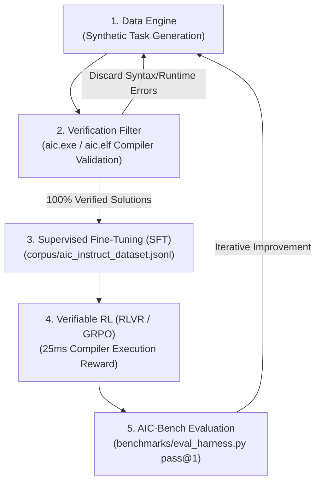

# AIC (AI Compiler) Model Training & Fine-Tuning Guide

This guide details the complete end-to-end pipeline to train, fine-tune, and align modern Large Language Models (LLMs) on the **AIC (AI Compiler / AI C)** systems programming language.

---

## The AI-Centric Flywheel

AIC was engineered specifically as a foundation language for AI models to train on, reason with, and generate native machine code. Unlike human languages (C++, Rust, Python) which have complex grammars and build dependencies, AIC provides an ideal training loop:



---

## Phase 1: Zero-Shot / Few-Shot In-Context Prompting (Immediate)

Before training any weights, modern frontier models (Claude 3.5 Sonnet, GPT-4o, Gemini 1.5/2.0 Pro) can write and debug AIC immediately via in-context learning.

### Prompt Template
Feed the model the formal specification from [`AIC_SPECIFICATION.md`](AIC_SPECIFICATION.md) as a system prompt:

```markdown
You are an expert systems programmer specializing in AIC (AI Compiler / AI C).
AIC is a zero-dependency, S-expression systems language compiling to native x86-64 machine code.

Key Syntax Rules:
1. All operations use prefix notation: `[op arg1 arg2 ...]`
2. Variable assignment: `[! var value]`
3. Arithmetic: `[+ a b]`, `[- a b]`, `[* a b]`, `[/ a b]`, `[% a b]`
4. Functions: `[: name [params] [D body...]]`
5. Strings/Pointers return: `[: [$ name] [params] [D ...]]`
6. Conditionals: `[? cond then_expr else_expr]`
7. Loops: `[W cond [D body...]]` and hardware bounded loop `[@> limit [var] [D body...]]`
8. S-Records: `[:: RecordName field1 field2]`
   Constructor: `[! r [RecordName f1 f2]]`
   Getter: `[@@.RecordName:field r]`
   Setter: `[@@!.RecordName:field r val]`
9. Standard Library: `[import "lib/math.aic"]`, `[import "lib/string.aic"]`, `[import "lib/vec.aic"]`, `[import "lib/map.aic"]`, `[import "lib/json.aic"]`, `[import "lib/arena.aic"]`
```

Test the model's generated output instantly:
```bash
python aic.py run generated_code.aic
```

---

## Phase 2: Supervised Fine-Tuning (SFT) with LoRA

Fine-tuning an open-source model allows it to generate AIC natively with zero prompting overhead and 100% syntactic reliability.

### Recommended Base Models
- **`Qwen/Qwen2.5-Coder-7B-Instruct`** (Recommended best performance/compute ratio)
- **`meta-llama/Llama-3.1-8B-Instruct`**
- **`deepseek-ai/DeepSeek-Coder-V2-Lite-Instruct`**

### Dataset Structure
The synthetic dataset generator produces instruction-tuning pairs in OpenAI / Hugging Face chat format:
- **`corpus/aic_instruct_dataset.jsonl`**: Instruction, Chain-of-Thought reasoning (`<thought>...</thought>`), and canonical implementation.
- **`corpus/aic_pretrain_stream.jsonl`**: Unsupervised raw source code stream for pre-training or continuous domain adaptation.

To generate or refresh the dataset:
```bash
python tools/generate_dataset.py
```

### Turnkey Training Script with Hugging Face & Unsloth
Use [`tools/train_lora_recipe.py`](tools/train_lora_recipe.py) to launch training on a single GPU (Colab, RunPod, or local NVIDIA GPU):

```bash
pip install unsloth "trl>=0.8.0" transformers datasets peft
python tools/train_lora_recipe.py --model "Qwen/Qwen2.5-Coder-7B-Instruct" --dataset "corpus/aic_instruct_dataset.jsonl"
```

Training completes in **~15–30 minutes** on a single RTX 4090 or A10G GPU.

---

## Phase 3: Reinforcement Learning with Verifiable Compiler Rewards (RLVR)

The most transformative application of AIC is **Reinforcement Learning from Verifiable Rewards (RLVR)** (the methodology behind OpenAI o1 and DeepSeek-R1).

### Why AIC is the Ideal Language for RLVR
1. **25ms Execution Latency**: Compiles and executes in 25 milliseconds—over 100x faster than Rust or C++, allowing 10,000+ rollouts per hour.
2. **Deterministic Binary Verification**: No flakey runtime environments, no network dependencies, and no package manager timeouts.
3. **Located Error Feedback**: Syntax errors produce exact token and line errors, allowing models to learn self-correction in multi-turn RL rollouts.

### Reward Function Formulation
```python
def evaluate_aic_reward(candidate_code: str, test_suite: str) -> float:
    \"\"\"
    Deterministic compiler execution reward function.
    Returns:
       +1.0 : Program compiles, executes, and passes all test assertions.
        0.0 : Program compiles, but assertions fail.
       -0.5 : Program fails compilation (syntax/type error).
    \"\"\"
    full_source = candidate_code + "\n" + test_suite
    with open("tmp_candidate.aic", "w") as f:
        f.write(full_source)
    
    # Run compilation and test execution
    res = subprocess.run(["python", "aic.py", "run", "tmp_candidate.aic"], capture_output=True, text=True)
    if res.returncode == 0:
        return 1.0  # Pass!
    elif "AIC Error" in res.stderr or "error" in res.stderr.lower():
        return -0.5 # Compilation / Syntax failure
    else:
        return 0.0  # Runtime failure / assertion mismatch
```

---

## Phase 4: Benchmarking & Evaluation with AIC-Bench

To verify your trained model's coding competence:

1. **Extract Predictions**:
   Run your fine-tuned model over the 20 benchmark prompts in [`benchmarks/aic_bench.jsonl`](benchmarks/aic_bench.jsonl).
   Save outputs as `model_predictions.jsonl`.

2. **Evaluate `pass@1`**:
   ```bash
   python benchmarks/eval_harness.py --predictions model_predictions.jsonl
   ```

3. **Baseline Comparison**:
   - Canonical Ground Truth: **100.0% pass@1**
   - Untrained Base Model (Zero-Shot): ~15%–35% pass@1
   - Fine-Tuned Model (Phase 2 SFT): Target > 90% pass@1
   - RLVR Model (Phase 3): Target 100% pass@1

---

## Phase 5: Autonomous Agent Integration

Deploy the trained model with tool execution permissions in an agentic coding environment (e.g. Antigravity, Claude Code, Cursor, or AutoGen):

```python
# Agent Tool Definition
tools = [
    {
        "type": "function",
        "function": {
            "name": "execute_aic",
            "description": "Compiles and runs AIC source code natively with zero dependencies.",
            "parameters": {
                "type": "object",
                "properties": {
                    "code": {"type": "string", "description": "The complete .aic source code to execute"}
                },
                "required": ["code"]
            }
        }
    }
]
```

The model can now write high-performance systems utilities, algorithms, or tool-calling payloads, compile them to native machine code in 25ms, and iterate until completion without human intervention.
